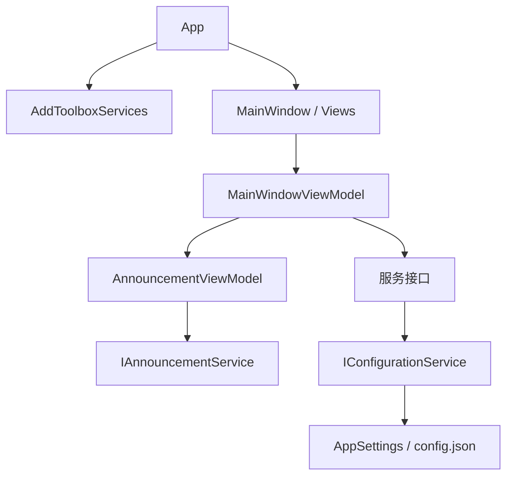

# 架构与命名

项目继续采用单个 WPF 应用和按功能分组的服务。依赖注册集中在 `Infrastructure/DependencyInjection/ServiceCollectionExtensions.cs`，`App` 负责应用启动、协议确认、窗口创建和退出清理。



## 职责与边界

| 位置 | 职责 |
| --- | --- |
| `Models/Configuration` | 配置的 CLR 类型及 JSON 字段映射，不负责文件读写。 |
| `Models/ApplicationState.cs` | 本次运行的游戏路径、工具箱版本和模式状态；它是普通状态对象，不宣称会通知 WPF 属性变化。 |
| `Services/Configuration` | 加载和保存配置。调用方依赖 `IConfigurationService`，实现只在依赖注册处选择。 |
| `Services/<功能>` | 功能接口、实现及结果类型。同一类型可按文件名找到，接口文件不再夹带实现或结果类型。 |
| `ViewModels/AnnouncementViewModel.cs` | 公告内容、阅读提示、倒计时及确认按钮可用状态；独立管理计时器。 |
| `ViewModels/MainWindow` | 启动、导航与功能间协调。安装、皮肤、字体、抽卡、设置、灰度和内容逻辑分别组织。 |
| `Views/Dialogs` | 所有对话框的 XAML 和代码后置。服务使用的输入类型、按钮与结果放在 `Services/UI`。 |
| `Infrastructure/DependencyInjection` | 统一注册实现与生命周期，启动时启用依赖图校验。 |

公告页面直接绑定 `Announcement.Content`、`Announcement.Tip`、`Announcement.CanAcknowledge` 和 `Announcement.ShowTip`。主窗口只决定何时切换到公告页面，以及确认后是否继续自动安装。主窗口的其他 partial 文件仍属于同一个对象，按文件拆分本身不代表业务解耦。

## 命名约定与迁移

新增类型、公开属性和方法使用 PascalCase；私有字段使用 `_camelCase`。异步操作以 `Async` 结尾，名称说明业务对象，避免把文件路径称为目录、把模组版本与工具箱版本混为一谈。

| 原名称 | 当前名称 |
| --- | --- |
| `ConfigurationManager` / `SaveConfig()` | `IConfigurationService` / `ConfigurationService.Save()` |
| `ConfigModel.cs` 中的配置类 | `Models/Configuration/AppSettings.cs` 与各项 `*Settings.cs` |
| `AppState` | `ApplicationState` |
| `LimbusCompanyDir` / `LimbusCompanyGameDir` | `GameDirectory` / `GameExecutablePath` |
| `CurrentDir` / `Version`（运行状态） | `BaseDirectory` / `ToolboxVersion` |
| `GreytestStatus` / `GreytestUrl` | `IsGreytestMode` / `GreytestDownloadUrl` |
| `IVersionService` / `VersionService` | `IModVersionService` / `ModVersionService` |
| `SimpleDNSChecker.cs` / `SimpleDnsChecker` | `DnsResolverChecker.cs` / `DnsResolverChecker` |
| `InputMirrorChyan` | `Views.Dialogs.MirrorChyanKeyDialog` |
| `InitializeSkinComboBoxAsync` | `RefreshSkinCatalogAsync` |

配置属性使用完整名称，例如 `Settings.General.GameDirectory`、`Settings.Installation.InstallOnLaunch` 和 `Settings.Announcements.LastReadVersion`。每个属性通过 `JsonProperty` 显式映射已有字段，所以保存后的键仍然是 `LCBPath`、`installWhenLaunch`、`annoVersion` 等，用户不需要迁移配置。未知字段与 `_` 注释字段沿用忽略策略。缺失或为 null 的成员保留模型初始值，例如公告默认开启、皮肤默认 `default`。

资源目录、`config.json` / `NodeList.json` / `loadingText.json` 文件名、远端 API 字段、皮肤 JSON 格式以及皮肤依赖的控件名保持兼容。不要对这些外部标识做无映射的批量改名。

## 生命周期与持久化

配置保存通过实例锁串行执行，先写同目录临时文件，再替换目标文件，避免直接截断正在使用的配置。`Settings` 仍是可变对象；保存锁不提供跨多个属性修改的事务或不可变快照，后续需要统一配置修改入口才能进一步解决这类竞争。

容器在应用退出时释放 `MainWindowViewModel` 和 `AnnouncementViewModel`，停止加载文案、公告倒计时并解除服务事件订阅。遥测取消源由退出流程取消，后台任务结束后再释放，避免任务提前结束后退出流程对已释放对象调用 `Cancel()`。

尚未迁移的边界包括：安装和皮肤页面仍依赖主窗口状态；主窗口仍一次创建所有页面；部分服务仍直接使用 WPF 对话框；皮肤管理器仍有静态入口。这些改动需要配合页面宿主和皮肤元素定位机制，不能仅移动文件完成。

## 验证

```powershell
# 服务回归：不访问真实业务服务器，不依赖 Windows Desktop Runtime
dotnet run --project tests/StartupChecks/StartupChecks.csproj -c Release

# Windows：COM 引用需要 Visual Studio 的 MSBuild
dotnet restore .\LLC_MOD_Toolbox.csproj
msbuild .\LLC_MOD_Toolbox.sln /m /p:Configuration=Release
msbuild .\LLC_MOD_Toolbox.sln /m /p:Configuration=Debug
```

服务检查覆盖原有的 11 项网络预算与文案缓存行为，并补充 5 项配置检查：全部旧字段往返、缺省与 null 成员、注释及未知字段、并发保存、缺失文件和损坏文件处理。

本轮验证：16/16 项服务检查通过；在 Linux 的临时副本中开启 `EnableWindowsTargeting`，使用 COM 编译替身，Debug / Release 的 C# 和 XAML 编译均为 0 错误。仍有 `MainWindow.Background`、`MainWindow.Close` 与继承成员同名的既有警告（WPF 临时程序集重复报告，共 4 条）；保留这些控件名以兼容现有皮肤。正式项目的 COM 引用未修改。

Windows 验收重点：旧配置启动、普通/重要/特殊公告及确认后自动安装、四类对话框、皮肤切换、Debug 热重载、启动中关闭窗口。跨平台编译无法替代这些 WPF 交互验证。
